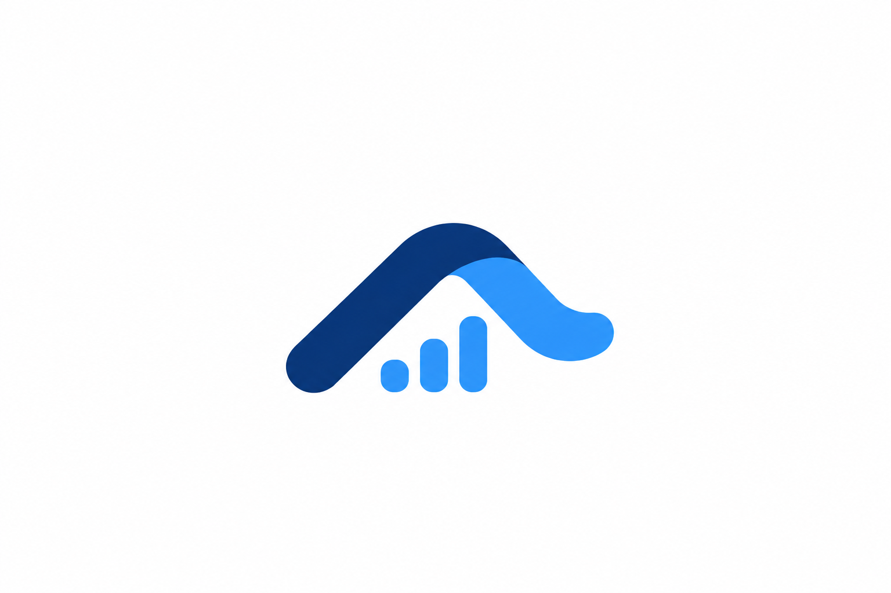
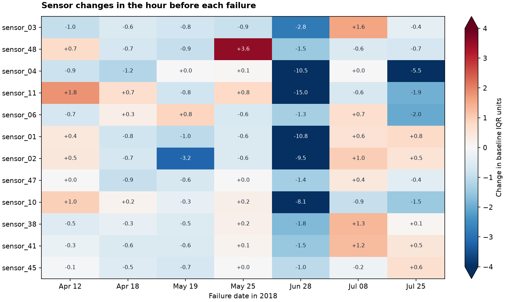
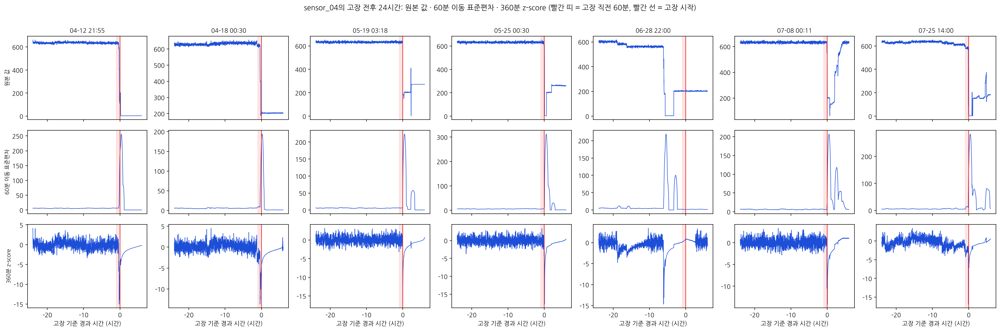
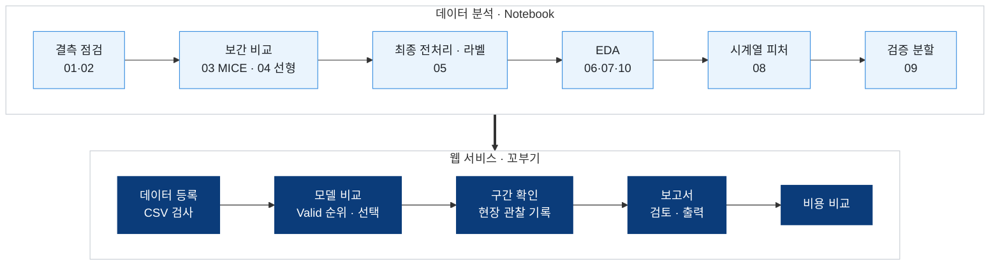

<div align="center">



# 꼬부기

### 펌프 모델 비교와 점검 보고서 자동화

포스코 K-뉴딜 아카데미 「설비 고장을 예측하는 AI 데이터 분석」 해커톤 프로젝트
<br>


<br>


<br>

[프로젝트 소개](#1-프로젝트-소개) · [분석 결과](#2-분석-결과) · [진행 흐름](#3-프로젝트-진행-흐름) · [웹 서비스](#4-웹-서비스) · [실행 방법](#5-개발-환경-및-실행) · [산출물](#9-산출물)

</div>
<br>

## 1. 프로젝트 소개

> 모델 결과를 확인한 뒤에도 **현장 관찰 정리, 근거 검색, 보고서 작성과 담당자 간 전달**이 남습니다.
> 꼬부기는 전처리된 펌프 데이터로 모델을 비교하고, 사람이 고른 결과와 현장 관찰을 연결해 점검 기록과 보고서까지 이어줍니다.

**분석 데이터: [Kaggle Pump Sensor Data](https://www.kaggle.com/datasets/nphantawee/pump-sensor-data)**

| 항목 | 내용 |
| --- | --- |
| 규모 | `sensor.csv` 220,320행 · 센서 52개(`sensor_00`~`sensor_51`) |
| 기간 | 2018-04-01 00:00 ~ 2018-08-31 23:59 · 1분 간격 |
| 상태 | `NORMAL` 205,836행 · `RECOVERING` 14,477행 · `BROKEN` 7행(고장 7건) |
| 결측 | `sensor_15` 전체 결측 · `sensor_50` 약 35% 결측 · 11행은 모든 센서가 비어 있음 |

* 공개된 물 펌프 데이터이며 철강 현장 데이터가 아닙니다. 센서 단위·위치, 고장 원인, 실제 정비 비용은 제공되지 않습니다.
* 학습용 라벨은 `NORMAL` → `normal`(0), `BROKEN`·`RECOVERING` → `abnormal`(1)로 만들고 원본 상태는 별도로 보존합니다.

<br>

## 2. 분석 결과

### 최종 전처리

* 센서 **49개** 사용: `sensor_15`(전체 결측), `sensor_50`(약 35% 결측), `sensor_51` 제외
* 결측 **31,854개**를 시간 기준 선형보간으로 채움 → `data/processed/sensor_linear_interpolation_labeled.csv`
* `sensor_51`은 6월 28일 고장을 포함한 15,356분 연속 결측의 양쪽 값이 모두 1,000이라, 보간하면 고장 전후가 평평한 1,000으로 채워져 제외했습니다.
* LightGBM MICE와 선형보간을 전체 기간에서 비교한 뒤 선형보간을 최종 방식으로 정했습니다.

### 고장 직전 패턴 (고장 7건)

<div align="center">
  
  <br>
  <sub>고장 직전 1시간의 센서 변화 (기준 구간 IQR 단위). 6월 28일 고장에서 여러 센서가 크게 하락</sub>
</div>
<br>

* `sensor_03`·`sensor_48`은 고장 직전 1시간에 7건 중 5건에서 기준 구간보다 하락했습니다.
* 같은 시각의 정상 구간과 비교하면 `sensor_04`의 하락이 3건에서 정상 참고 범위를 벗어났습니다.
* `sensor_19·20·21`은 정상·회복 모두에서 상관이 높아 대표 센서로 줄여볼 후보입니다.

### 시계열 피처와 단일 센서 경보 규칙

센서 49개에 대해 rolling 평균·표준편차·최소·최대(15·60·360분), 변화량(1·5·15·60분), 360분 z-score로 **피처 882개**를 만들었습니다.
가장 단순한 기준선으로 "**|z360| ≥ 4**이면 경보" 규칙을 고장 전 6시간 범위에서 시험했습니다.

| 센서 | 적중 (7건 중) | 선행 시간 중앙값 | 정상 구간 오경보 | 오경보 에피소드 |
| --- | :---: | :---: | :---: | :---: |
| ⭐ **sensor_04** | **7** | **21분** | **0.13%** | **93** |
| sensor_12 | 6 | 175.5분 | 0.53% | 130 |
| sensor_14 | 6 | 208분 | 0.82% | 476 |
| sensor_06 | 6 | 80분 | 1.07% | 750 |
| sensor_00 | 6 | 26분 | 1.09% | 487 |

<div align="center">
  
  <br>
  <sub>sensor_04의 고장 전후 원본 값 · 60분 이동 표준편차 · 360분 z-score (빨간 선 = 고장 시작)</sub>
</div>

> [!NOTE]
> * 전체 기간 7건으로 탐색한 결과이며, 검증된 모델 성능이 아닙니다.
> * `abnormal`의 대부분은 회복 구간이므로, 상태 분류 성능을 고장 발생 예측 성능으로 해석하지 않습니다.
> * 모델 검증은 날짜 기준 단일 분할 대신 **고장 사건 단위 전진 검증 폴드 6개**로 설계했습니다([분할 명세](docs/validation_split.json)).

자세한 수치와 해석은 [분석 인수인계 문서](docs/pump_analysis_handoff.md)와 [피처 명세](docs/feature_spec.json)를 참고해주세요.

<br>

## 3. 프로젝트 진행 흐름



### 데이터 분석

| Notebook | 내용 |
| --- | --- |
| `01_pump_missingness_audit` | 원본 52개 센서의 결측 현황 |
| `02_pump_sensor_timeseries` | 결측을 포함한 센서별 원본 시계열 |
| `03_pump_lightgbm_mice` | 전체 기간 LightGBM MICE 비교 실험 |
| `04_pump_linear_interpolation` | 전체 기간 선형보간 비교 실험 |
| `05_pump_binary_labels` | **최종 전처리 CSV**(선형보간 · 원본 상태 · 라벨) 생성 |
| `06_pump_sensor_eda` | 정상·회복 분포, 실제 고장 7건, 같은 시각의 정상 대조군 |
| `07_pump_sensor_correlation` | 상태별·보간 전후 센서 상관관계 |
| `08_pump_rolling_features` | rolling·변화량·z-score 피처와 단일 센서 경보 규칙 |
| `09_pump_validation_split` | 고장 사건 단위 전진 검증 폴드 설계 |
| `10_pump_selected_sensor_timeseries` | 센서 49개의 보간 값과 60분 이동평균, 고장·회복 구간 |

> 08은 05가 만든 최종 전처리 CSV를 읽으므로 **05를 먼저 실행**합니다.

<br>

## 4. 웹 서비스

전처리한 CSV를 올리면 형식을 검사하고, 모델을 학습·비교한 뒤 **사람이 선택한 결과와 현장 관찰을 묶어 검토 기록과 보고서로 남기는** 웹 서비스입니다.

| 화면 | 내용 |
| --- | --- |
| 작업실 | 등록한 데이터, 학습 현황, Test 평가 완료 건수와 다음 할 일 |
| 데이터 | CSV 업로드 · 시간·라벨·채널 검사 결과와 수정할 위치 안내 |
| 모델 비교 | XGBoost · LightGBM · AutoEncoder 학습 → Valid 지표 순위 → 사용자 선택 → Test 평가 |
| 구간 확인 | 시계열·원본 라벨·예측 구간 확인, 현장 관찰 기록(수정 이력 보존) |
| 보고서 | 모델 결과·관찰을 근거로 검토 저장·완료, 보고서 내려받기 |
| 비용 비교 | 두 시나리오의 점검비 + 수리비 + 생산중단시간 × 시간당 손실 비교 |

**설계 원칙**

* 🔐 로그인한 계정으로 작성·수정 이력을 남기며, 미인증 접근을 막습니다.
* 🧪 결측을 몰래 채우거나 특징을 자동 추가하지 않고, 오류가 있으면 원인과 위치를 알려줍니다.
* 📊 순위는 같은 Valid 셋 지표로 매기고, 최종 모델은 사용자가 선택한 뒤 Test를 따로 평가합니다.
* 💸 입력하지 않은 비용은 0원으로 보지 않으며, 분류 확률을 고장 확률이나 절감률로 바꾸지 않습니다.

> [!NOTE]
> 관찰·모델 결과·검색 문서를 구분해 점검 보고서 초안을 쓰는 **RAG 기능은 개발 중**입니다.
> 화면의 예시 관찰 문장과 미리보기 수치는 시연용이며, 실제 현장 관찰이나 확인된 고장 사실이 아닙니다.

<br>

## 5. 개발 환경 및 실행

| 구분 | 사용 도구 |
| --- | --- |
| 분석 | Python 3.14 · Conda · Jupyter · pandas · NumPy · scikit-learn · LightGBM · Matplotlib |
| 백엔드 | Python 3.12 · uv · FastAPI · SQLAlchemy · SQLite · XGBoost · LightGBM · PyTorch |
| 프런트엔드 | React 19 · TypeScript · Vite · pnpm |
| 배포 | Docker · Render (512MB 환경 부하 검사 CI) |

**분석 환경**

```bash
conda env create -f environment.yml
conda activate kkobugi
```

원본 `sensor.csv` 또는 `archive.zip`을 `data/`에 넣고 노트북을 순서대로 실행합니다. 커밋 전에는 실행 번호와 실행 시각 기록을 지웁니다.

```bash
python src/clear_execution_count.py
```

**백엔드** · http://127.0.0.1:8000/docs

```bash
cd backend
uv sync --group dev
uv run uvicorn app.main:app --reload --host 127.0.0.1 --port 8000
```

공개 회원가입은 없으며 계정은 관리 명령(`uv run python -m app.cli create-user`)으로 만듭니다. 자세한 내용은 [backend/README.md](backend/README.md)와 [API.md](backend/API.md)를 참고해주세요.

**프런트엔드** · http://127.0.0.1:5173

```bash
cd frontend
pnpm install
pnpm dev
```

**Docker** (프런트 빌드와 API를 함께 실행)

```bash
docker build -t kkobugi .
docker run --rm -p 10000:10000 -e 'KKOBUGI_TRUSTED_ORIGINS=["http://127.0.0.1:10000"]' kkobugi
```

> 그림은 저장소의 [나눔고딕](fonts/)과 matplotlib 내장 글꼴만 사용해 Windows·macOS 어디서 실행해도 같은 결과가 나옵니다.

<br>

## 6. 프로젝트 구조

```text
kkobugi/
├── README.md
├── environment.yml             # 분석용 Conda 환경
├── Dockerfile · render.yaml    # 배포 설정
├── data/                       # 원본·전처리 데이터 (Git 제외)
├── notebooks/                  # 분석 Notebook 01~10
├── src/                        # 결측 점검·피처·검증 분할·그림 설정 코드
├── figures/                    # EDA·피처·검증 분할 그래프
├── fonts/                      # 그래프용 나눔고딕 (OFL)
├── docs/                       # 개발 기획서·분석 인수인계·피처/분할 명세
├── backend/                    # FastAPI 서버 (인증·데이터 검사·학습·검토)
│   ├── app/
│   └── tests/
├── frontend/                   # React 웹앱
│   └── src/
└── .github/workflows/          # Render 이미지 부하 검사 CI
```

원본 데이터는 각자 로컬 `data/` 폴더에 저장하며 GitHub에 올리지 않습니다.

<br>

## 7. 팀원

<div align="center">

| 박민호 (팀장) | 강민준 | 김수민 | 이하일 | 이한결 |
| :---: | :---: | :---: | :---: | :---: |
| RAG 기반 챗봇 개발 | 데이터 분석 · 시계열분석  | 데이터 분석 · 발표자료제작 | 데이터 분석 · 해석 | RAG 자료 조사 · 보고서 작성 |

</div>
<br>

## 8. 협업 규칙

* 브랜치는 각자 작업 브랜치에서 작업하고 PR로 `main`에 합칩니다.
* 커밋 메시지는 `feat:` · `fix:` · `docs:` · `chore:` 형식을 사용합니다.
* `data/`, `.env`, 학습 결과(`backend/.runtime/`)는 커밋하지 않습니다.
* 노트북은 커밋 전에 `python src/clear_execution_count.py`를 실행합니다.

<br>

## 9. 산출물

| 산출물 | 위치 |
| --- | --- |
| 📄 개발 기획서 | [docs/꼬부기_개발기획서.docx](docs/꼬부기_개발기획서.docx) |
| 📝 분석 인수인계 | [docs/pump_analysis_handoff.md](docs/pump_analysis_handoff.md) |
| 🧮 피처 명세 · 검증 분할 명세 | [docs/feature_spec.json](docs/feature_spec.json) · [docs/validation_split.json](docs/validation_split.json) |
| 💻 데이터 분석 코드 | [notebooks/](notebooks/) · [src/](src/) |
| 📈 분석 그래프 | [figures/](figures/) |
| 🖥️ 웹 서비스 | [backend/](backend/) · [frontend/](frontend/) |

<br>

---

<div align="center">
  <sub>꼬부기 · 포스코 K-뉴딜 아카데미 「설비 고장을 예측하는 AI 데이터 분석」</sub>
</div>
